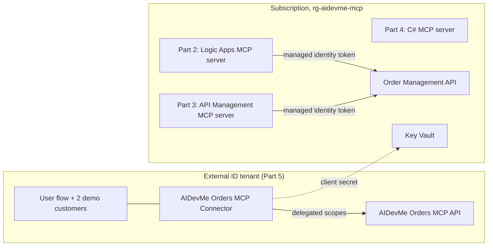

<!-- cspell:ignore aidevme aidevmesamples aidevmesamplescustomers onmicrosoft ciamlogin containerapp apim keyvault westeurope northeurope swedencentral germanywestcentral switzerlandnorth francecentral MSYS PATHCONV logicapp azurecr appi addPassword oid oids Consumption Precondition uuidgen SPID pipefail ASPNETCORE mktemp serverfarms deletedservice apikey mcpservers authsettings -->

# Azure provisioning guide

This guide describes every step that builds the Azure and Microsoft Entra environment for the series **Custom MCP
servers for Copilot Studio**: two tenants, one subscription, the shared base, the Order Management API and the three
build paths (Parts 2, 3 and 4). It records the run of 15 November 2026 in a new subscription, including the errors
and their fixes, so you can repeat it without the same detours.

The guide covers Azure and Entra only. Copilot Studio, the Power Platform environments and the DLP policy (Parts 1,
5 and 7) are separate.

## How to read this guide

- **Order.** The phases build on each other. Each phase ends with a check and the values the next phase needs.
- **Where the commands run.** Bash (Git Bash on Windows, Linux, macOS or the Cloud Shell), from the repo root, unless
  a step says otherwise. Steps marked **Portal** have no CLI or API equivalent, or the portal is simpler.
- **Values.** Every ID, key and host you create goes into the local, gitignored file `.env/.env`. Copy
  [`.env/.env.example`](../../.env/.env.example) to start. The commands use the same variable names, so load the file
  once per shell:

  ```sh
  set -a; source .env/.env; set +a
  ```

  If the file has Windows line endings, convert it first (`sed -i 's/\r$//' .env/.env`), or the values end in `\r`.
- **Never commit IDs.** Tenant and subscription IDs, keys, secrets and the real host names stay in `.env/.env`. The
  repo uses placeholders such as `<external-tenant-id>`.

## What you end up with

| Layer | Name in this guide | Purpose |
| --- | --- | --- |
| Workforce tenant | AIDevMe Samples (`<samples-domain>.onmicrosoft.com`) | Holds the subscription, the managed identities and the Order Management API registration. Separate from your production tenant |
| Subscription | AIDevMe Samples | Every billable resource, with a monthly budget |
| External ID tenant | AIDevMe Samples Customers (`<external-domain>.ciamlogin.com`) | Customer sign-in for Part 5: two app registrations, a user flow, two demo customers |
| Resource group `rg-aidevme-tenants` | — | The billing resource of the External ID tenant. Keep it |
| Resource group `rg-aidevme-mcp` | — | Everything else. Delete it after a test session |



The Part 4 server keeps its own in-memory data and doesn't call the Order Management API.

## Costs

| Resource | Tier | Approximate cost | Advice |
| --- | --- | --- | --- |
| Logic Apps Standard plan | WS1 | About $175 a month (Learn's illustration) | Deploy for a test session, then delete |
| API Management | Developer | About $48 a month (West Europe list price) | Deploy for a test session, then delete |
| Container Apps (2 apps, 1 replica each) | Consumption | Low | Can stay |
| Container registry | Basic | Low, billed per day | Created by `az containerapp up` |
| Log Analytics, Application Insights, Key Vault | Pay as you go | Small | Can stay |
| External ID | Monthly active users | The first tier is free; check the current pricing | Two demo customers |

WS1 and API Management together cost more than a 100 CHF budget for a full month. Check the pricing pages for your
region; the numbers above come from the posts.

## Prerequisites

| Tool or access | Version or detail |
| --- | --- |
| Azure CLI | 2.87.0 or newer, with Bicep and the `containerapp` extension (`az extension add --name containerapp`) |
| Bash | Git Bash, Linux, macOS or the Cloud Shell |
| `curl`, `zip`, `python3` | Used by the deploy and test scripts |
| PowerShell 7 | For the contract test |
| Entra role | Global Administrator in your production tenant (to create tenants) |
| Billing role | Owner or contributor on a billing account with a Microsoft Customer Agreement (to create a subscription) |

**Git Bash on Windows** needs three workarounds:

| Problem | Symptom | Fix |
| --- | --- | --- |
| Path conversion | `az ... --scope "/"` fails with `MissingSubscription`, because Git Bash turns `/` into a Windows path | Prefix the command: `MSYS_NO_PATHCONV=1 az ...` |
| `python3` | Resolves to the Microsoft Store stub and exits with code 49 | Put a `python3` script that calls your real `python.exe` first on `PATH`, or install Python from python.org with "Add to PATH" |
| `zip` | Not installed | Install it, or create the zip with Python (`python -m zipfile -c workflows.zip ...`) |

---

## Phase 1: tenant and subscription

Keep the samples out of your production tenant. A separate workforce tenant means that app registrations, managed
identities and role assignments of the demo never touch production, and that one subscription holds all costs.

### 1.1 Create the workforce tenant (Portal)

1. Open the [Microsoft Entra admin center](https://entra.microsoft.com), signed in to your production tenant.
2. Go to **Entra ID → Overview → Manage tenants → Create**, and choose **Microsoft Entra ID** (the workforce type, not
   **External**).
3. Fill in:

   | Field | Value |
   | --- | --- |
   | Organization name | `AIDevMe Samples` |
   | Initial domain name | For example `aidevmesamples`, giving `aidevmesamples.onmicrosoft.com`. Must be globally unique |
   | Country/Region | Your country. You can't change it later |

4. Select **Review + create**, then **Create**. Creation takes a few minutes.

Your account becomes Global Administrator of the new tenant. According to Microsoft, only paid customers can create
additional workforce tenants; a free or trial account can't.

Record the tenant ID as `SAMPLES_TENANT_ID` in `.env/.env`.

### 1.2 Verify a custom domain (Portal, optional)

Only needed if you want sign-in names on your own domain, such as `aidevme-samples.com`. Not done in the recorded run.

1. Switch to the new tenant (gear icon → **Directories**).
2. **Entra ID → Domain names → Add custom domain**, enter the domain.
3. Add the TXT record that Entra shows (`MS=ms…`) at your DNS provider, host `@`, TTL 3600.
4. Select **Verify**, then optionally **Make primary**.

A domain can be verified in only one tenant.

### 1.3 Create the subscription (Portal)

1. In the [Azure portal](https://portal.azure.com), go to **Subscriptions → + Add**.
2. Fill in:

   | Field | Value |
   | --- | --- |
   | Subscription name | `AIDevMe Samples` |
   | Billing account, billing profile | The ones that already pay your Azure costs. One profile means one invoice |
   | Invoice section | Your existing section, or a new section "AIDevMe Samples" to list the demo costs separately |
   | Plan | Microsoft Azure Plan |
   | Subscription directory | **AIDevMe Samples**, if the form offers it. Then skip step 1.4 |

3. Create the subscription. Check the billing account's status first: a subscription on a profile with a payment
   warning can be disabled.

Record the subscription ID as `AZURE_SUBSCRIPTION_ID`.

### 1.4 Move the subscription into the workforce tenant (Portal)

Only if the subscription was created in the production tenant. Move it **while it's empty**: a directory change
removes every role assignment and breaks managed identities and Key Vault access policies. There's no `az` command
for it.

**Send the request**, in the production tenant:

1. **Subscriptions → AIDevMe Samples → Overview → Change directory**.
2. Read the warnings. For an empty subscription, they don't matter.
3. Under "Will you be the acceptor?", choose **Yes**.
4. Destination: **AIDevMe Samples**. Select **Continue**.

**Elevate your access in the target tenant.** Global Administrator is an Entra role, not an Azure role, so it isn't
enough to accept a transfer. The portal reports "Your current settings do not allow you to transfer".

1. Switch to **AIDevMe Samples**. Check the directory name at the top right.
2. **Entra ID → Overview → Properties → Access management for Azure resources = Yes → Save**.
3. Sign out and sign in again. The elevation takes effect only in a new token.

**Accept the transfer**: open the **Accept transfer** page again (or the link from the request) and select **Accept**.
The request stays "Initiated" until then, so you don't need to start over after the elevation.

If it's still blocked, check **Subscriptions → Manage policies** in both tenants: "Subscription entering Microsoft
Entra tenant" (target) and "Subscription leaving Microsoft Entra tenant" (source) must both allow the move.

**After the transfer:**

1. In AIDevMe Samples, open **Subscriptions → AIDevMe Samples → Access control (IAM)** and check that you have
   **Owner**. Add the role if you don't.
2. Remove the elevation (step 1.5).

The subscription can take a few minutes to show up. Check the global subscription filter, or sign out and in.

### 1.5 Remove the elevation

The elevation gives you User Access Administrator at the root scope `/` of the tenant. Remove it in **both** tenants
once you no longer need it.

**Portal:** **Entra ID → Overview → Properties → Access management for Azure resources = No → Save**.

**CLI**, signed in to the tenant:

```sh
az login --tenant "$SAMPLES_TENANT_ID"
ME=$(az ad signed-in-user show --query id -o tsv)
MSYS_NO_PATHCONV=1 az role assignment list --scope "/" --role "User Access Administrator" \
  --query "[?principalId=='$ME'].{role:roleDefinitionName, scope:scope}" -o table
MSYS_NO_PATHCONV=1 az role assignment delete --assignee "$ME" --role "User Access Administrator" --scope "/"
```

**Check:** your subscription role assignments now show only **Owner** at the subscription scope:

```sh
az role assignment list --subscription "$AZURE_SUBSCRIPTION_ID" --all --include-inherited \
  --query "[].{role:roleDefinitionName, scope:scope}" -o table
```

### 1.6 Set a budget

A monthly budget of 100 in the billing currency, with alerts to the subscription Owners at 50, 80 and 100 % of the
actual cost and at 100 % of the forecast. The REST call works for any currency, because the amount is in the billing
currency of the subscription.

```sh
az account set --subscription "$AZURE_SUBSCRIPTION_ID"
cat > budget.json <<'EOF'
{
  "properties": {
    "category": "Cost",
    "amount": 100,
    "timeGrain": "Monthly",
    "timePeriod": { "startDate": "2026-11-01T00:00:00Z" },
    "notifications": {
      "actual50":    { "enabled": true, "operator": "GreaterThanOrEqualTo", "threshold": 50,  "thresholdType": "Actual",     "contactRoles": ["Owner"], "contactEmails": [] },
      "actual80":    { "enabled": true, "operator": "GreaterThanOrEqualTo", "threshold": 80,  "thresholdType": "Actual",     "contactRoles": ["Owner"], "contactEmails": [] },
      "actual100":   { "enabled": true, "operator": "GreaterThanOrEqualTo", "threshold": 100, "thresholdType": "Actual",     "contactRoles": ["Owner"], "contactEmails": [] },
      "forecast100": { "enabled": true, "operator": "GreaterThanOrEqualTo", "threshold": 100, "thresholdType": "Forecasted", "contactRoles": ["Owner"], "contactEmails": [] }
    }
  }
}
EOF
az rest --method put \
  --url "https://management.azure.com/subscriptions/$AZURE_SUBSCRIPTION_ID/providers/Microsoft.Consumption/budgets/budget-aidevme-samples-monthly?api-version=2023-05-01" \
  --body @budget.json \
  --query "{name:name, amount:properties.amount, grain:properties.timeGrain, alerts:keys(properties.notifications)}" -o json
rm budget.json
```

The start date must be the first day of the current month. A budget only alerts; it doesn't stop resources.

### 1.7 Register the resource providers

A new subscription has most providers unregistered. Register them once; it takes a few minutes.

```sh
for p in Microsoft.App Microsoft.OperationalInsights Microsoft.Insights Microsoft.KeyVault \
         Microsoft.ContainerRegistry Microsoft.ApiManagement Microsoft.Web Microsoft.Storage; do
  az provider register --namespace "$p" -o none
done
for p in Microsoft.App Microsoft.OperationalInsights Microsoft.Insights Microsoft.KeyVault \
         Microsoft.ContainerRegistry Microsoft.ApiManagement Microsoft.Web Microsoft.Storage; do
  echo "$p: $(az provider show --namespace "$p" --query registrationState -o tsv)"
done
```

Run the second loop again until every provider says `Registered`.

---

## Phase 2: External ID tenant (Part 5)

Customers sign in through a separate tenant with the **external** configuration. A workforce tenant can't serve as
one and can't be converted, and the Part 3 and Part 5 code uses the `ciamlogin.com` endpoints of an external tenant.

### 2.1 Create the external tenant (Portal)

Create it from inside AIDevMe Samples, so its billing resource sits in the samples subscription.

1. Entra admin center, switched to **AIDevMe Samples**: **Entra ID → Overview → Manage tenants → Create → External**.
   The Azure portal can't create external tenants.
2. Fill in:

   | Field | Value |
   | --- | --- |
   | Tenant name | `AIDevMe Samples Customers` |
   | Domain name | For example `aidevmesamplescustomers`, giving `.onmicrosoft.com` and `.ciamlogin.com`. Letters only is the safe choice; it must differ from the workforce tenant's name |
   | Country/Region | A European country, for the data location Europe |
   | Subscription | AIDevMe Samples |
   | Resource group | `rg-aidevme-tenants` (create it). Not `rg-aidevme-mcp`, which you delete after tests |

3. Create it. This takes several minutes.

Record the tenant ID as `EXTERNAL_TENANT_ID`.

### 2.2 Register the two apps

The commands are in [`src/identity/external-id/register-apps.sh`](../../src/identity/external-id/register-apps.sh),
steps 1 to 3. Sign in to the external tenant first. It has no subscription, so pass `--allow-no-subscriptions`:

```sh
az login --tenant "$EXTERNAL_TENANT_ID" --allow-no-subscriptions
[ "$(az account show --query tenantId -o tsv)" = "$EXTERNAL_TENANT_ID" ] || echo "wrong tenant"
```

Then run steps 1 to 3 of the script. They create:

| App | What the script sets |
| --- | --- |
| AIDevMe Orders MCP API | Single tenant (`AzureADMyOrg`), access token version 2, Application ID URI `api://<api-app-id>`, delegated scopes `Orders.Read` and `Returns.Create` (admin consent only), service principal |
| AIDevMe Orders MCP Connector | Single tenant, service principal, both scopes as delegated permissions, admin consent for all users |

Three details from the recorded run:

- **`uuidgen`** isn't available in Git Bash. Use `python -c "import uuid; print(uuid.uuid4())"` for the scope IDs.
- **Admin consent** can fail right after `az ad app permission add`, because the new service principal hasn't
  replicated yet. Wait about 20 seconds and run `az ad app permission admin-consent` again.
- **Customers can't consent** in an external tenant, so the admin consent is required.

Record the app IDs as `ORDERS_MCP_API_APP_ID` and `ORDERS_MCP_CONNECTOR_APP_ID`.

**Check:**

```sh
az ad app show --id "$ORDERS_MCP_API_APP_ID" \
  --query "{uri:identifierUris, tokenVersion:api.requestedAccessTokenVersion, scopes:api.oauth2PermissionScopes[].value}" -o json
SPID=$(az ad sp show --id "$ORDERS_MCP_CONNECTOR_APP_ID" --query id -o tsv)
az rest --method get --uri "https://graph.microsoft.com/v1.0/oauth2PermissionGrants?\$filter=clientId eq '$SPID'" \
  --query "value[].{consent:consentType, scope:scope}" -o table
```

Expect `tokenVersion` 2, both scopes, and one grant with `consentType` `AllPrincipals` and scope
`Orders.Read Returns.Create`.

Step 4 (the client secret) needs the Key Vault from Phase 3, and step 5 (the redirect URI) needs the Copilot Studio
wizard.

---

## Phase 3: shared base

[`src/infra/deploy-base.sh`](../../src/infra/deploy-base.sh) deploys [`src/infra/base.bicep`](../../src/infra/base.bicep)
into `rg-aidevme-mcp`:

| Resource | Name | Settings |
| --- | --- | --- |
| Log Analytics workspace | `log-aidevme-mcp` | `PerGB2018`, 30 days retention |
| Application Insights | `appi-aidevme-mcp` | Workspace-based, `web` |
| Key Vault | `kv-aidevme-mcp` | Standard, RBAC authorization, 7 days soft delete. The deployer gets **Key Vault Secrets Officer** |
| Container Apps environment | `cae-aidevme-mcp` | Logs to the workspace |

### 3.1 Pick a region that accepts the subscription

The posts use West Europe. In the recorded run, a new subscription got `RequestDisallowedByAzure: The selected region
is currently not accepting new customers`. Validate the template in a few regions before you deploy; validation
creates nothing except the resource group.

```sh
az login --tenant "$SAMPLES_TENANT_ID"
az account set --subscription "$AZURE_SUBSCRIPTION_ID"
az group create --name rg-aidevme-mcp --location northeurope -o none
ME=$(az ad signed-in-user show --query id -o tsv)
for r in westeurope northeurope swedencentral germanywestcentral switzerlandnorth francecentral; do
  out=$(az deployment group validate -g rg-aidevme-mcp --template-file src/infra/base.bicep \
    --parameters location=$r deployerPrincipalId=$ME --query properties.provisioningState -o tsv 2>&1)
  echo "$r: $(echo "$out" | grep -o 'Succeeded\|not accepting new customers' | head -1)"
done
```

North Europe, Sweden Central, Germany West Central, Switzerland North and France Central passed. North Europe was
used.

### 3.2 Deploy

The script deploys into the **current** subscription, so check it first:

```sh
[ "$(az account show --query id -o tsv)" = "$AZURE_SUBSCRIPTION_ID" ] || echo "wrong subscription"
LOCATION=northeurope bash src/infra/deploy-base.sh
```

The resource group's location is fixed once it exists. If a first run created it in a refused region, delete the
empty group and run again: `az group delete --name rg-aidevme-mcp --yes`.

**Check:**

```sh
az resource list -g rg-aidevme-mcp --query "[].{name:name, type:type, location:location}" -o table
KV=$(az keyvault show -n kv-aidevme-mcp --query id -o tsv)
MSYS_NO_PATHCONV=1 az role assignment list --assignee "$ME" --scope "$KV" --query "[].roleDefinitionName" -o tsv
```

Expect the four resources and `Key Vault Secrets Officer`. Key Vault names are global; pass `keyVaultName=` to
`base.bicep` if yours is taken.

---

## Phase 4: connector client secret

The connector app needs a client secret for the Copilot Studio OAuth wizard (Part 5). It goes straight into Key
Vault and never into a file or the terminal.

The script's step 4 uses `az ad app credential reset` and needs two sign-ins (external tenant, then the workforce
tenant for Key Vault). With both tokens cached, Microsoft Graph's `addPassword` does it in one go:

```sh
set -euo pipefail
TOKEN=$(az account get-access-token --tenant "$EXTERNAL_TENANT_ID" --resource-type ms-graph --query accessToken -o tsv)
SECRET=$(curl -s -X POST -H "Authorization: Bearer $TOKEN" -H "Content-Type: application/json" \
  "https://graph.microsoft.com/v1.0/applications(appId='$ORDERS_MCP_CONNECTOR_APP_ID')/addPassword" \
  -d '{"passwordCredential":{"displayName":"copilot-studio","endDateTime":"2027-11-15T00:00:00Z"}}' \
  | python3 -c "import sys,json;print(json.load(sys.stdin)['secretText'])")
unset TOKEN
az keyvault secret set --vault-name kv-aidevme-mcp --name orders-connector-secret --value "$SECRET" \
  --tags app=aidevme-orders-mcp-connector expires=2027-11-15 -o none
unset SECRET
```

The current `az` account must be the one with access to the Key Vault (the workforce tenant). Set `endDateTime` to
one year from today.

**Check** (metadata only, no value):

```sh
az keyvault secret show --vault-name kv-aidevme-mcp --name orders-connector-secret \
  --query "{name:name, created:attributes.created, tags:tags}" -o json
```

---

## Phase 5: Order Management API

The backend for Parts 2 and 3. It accepts only Entra tokens from managed identities you allow.

### 5.1 Register the API in the workforce tenant

```sh
az login --tenant "$SAMPLES_TENANT_ID"
bash src/order-api/infra/register-api-app.sh
```

The script creates "AIDevMe Order Management API" (single tenant), sets the App ID URI `api://<app-id>` and creates the
service principal. It's idempotent. Record `ORDER_API_CLIENT_ID`. The App ID URI is the audience that the logic app
(`OrderApi_Audience`) and API Management (`{{orders-api-app-id-uri}}`) request.

### 5.2 Deploy the container app

```sh
az account set --subscription "$AZURE_SUBSCRIPTION_ID"
ORDER_API_CLIENT_ID="$ORDER_API_CLIENT_ID" TENANT_ID="$SAMPLES_TENANT_ID" \
  bash src/order-api/infra/deploy-containerapp.sh
```

The script:

1. Builds `src/order-api/Dockerfile` in the cloud with `az containerapp up --source src/order-api`. No local Docker
   needed. Without `--registry-server`, it creates an Azure Container Registry (Basic) with a generated name. In the
   recorded run, that registry landed in **East US**, not in the environment's region.
2. Deploys `aidevme-orders-api` with external ingress on port 8080 and `Auth__Enabled=true`, `Auth__TenantId`,
   `Auth__ClientId`, `Auth__Audience`.
3. Pins it to one replica (the demo data lives in memory).
4. Calls `/health` and prints `ORDER_API_BASE_URL`.

Leave `ALLOWED_CALLERS` empty on the first run; the managed identities don't exist yet. Record `ORDER_API_BASE_URL`.

**Check:**

```sh
az containerapp show -n aidevme-orders-api -g rg-aidevme-mcp \
  --query "{state:properties.runningStatus, min:properties.template.scale.minReplicas, max:properties.template.scale.maxReplicas}" -o json
curl -s -o /dev/null -w "health %{http_code}\n" "$ORDER_API_BASE_URL/health"
curl -s -o /dev/null -w "orders without token %{http_code}\n" "$ORDER_API_BASE_URL/orders/SO-10023"
```

Expect `Running`, 1/1, `health 200` and `orders without token 401`.

---

## Phase 6: user flow and demo customers (Part 5)

All steps in this phase happen in **AIDevMe Samples Customers**. In the Entra admin center, switch tenant first.

### 6.1 Create the user flow (Portal)

1. **Entra ID → External Identities → User flows → + New user flow**.
2. Name: `aidevme-signup-signin`.
3. Identity providers: under **Email accounts**, choose **Email with password**. One-time passcode would need a real
   mailbox for every sign-in.
4. User attributes: **Display Name** only. The demo needs nothing but the `oid`.
5. **Create**.
6. Open the flow → **Applications → + Add application → AIDevMe Orders MCP Connector → Select**.

An app can belong to only one user flow, so add only the connector.

The link in step 6 also works through Graph, with the external-tenant token from Phase 4:

```sh
TOKEN=$(az account get-access-token --tenant "$EXTERNAL_TENANT_ID" --resource-type ms-graph --query accessToken -o tsv)
FLOW_ID=$(curl -s -H "Authorization: Bearer $TOKEN" "https://graph.microsoft.com/v1.0/identity/authenticationEventsFlows" \
  | python3 -c "import sys,json;print([f['id'] for f in json.load(sys.stdin)['value'] if f['displayName']=='aidevme-signup-signin'][0])")
curl -s -o /dev/null -w "link: %{http_code}\n" -X POST \
  -H "Authorization: Bearer $TOKEN" -H "Content-Type: application/json" \
  "https://graph.microsoft.com/v1.0/identity/authenticationEventsFlows/$FLOW_ID/conditions/applications/includeApplications" \
  -d "{\"@odata.type\":\"#microsoft.graph.authenticationConditionApplication\",\"appId\":\"$ORDERS_MCP_CONNECTOR_APP_ID\"}"
```

### 6.2 Create two demo customers (Portal)

Don't sign them up through the user flow: **Run user flow** needs a redirect URI on the connector app, which comes
from the Copilot Studio wizard later. Create them as an admin:

1. **Entra ID → Users → All users → + New user → Create new external user**.
2. Fill in:

   | Display name | Email | Customer in the demo data |
   | --- | --- | --- |
   | Demo Customer CU-3001 | `cu-3001@<your-sample-domain>` | `CU-3001` |
   | Demo Customer CU-3002 | `cu-3002@<your-sample-domain>` | `CU-3002` |

   The addresses don't need a mailbox; the customers sign in with email and password.
3. Let the portal generate a password, or set one. Keep it out of the repo.
4. Open each user and copy the **Object ID**. Record them as `DEMO_CUSTOMER_CU3001_OID` and `DEMO_CUSTOMER_CU3002_OID`.

**Check** that both are local accounts with an email identity:

```sh
for id in "$DEMO_CUSTOMER_CU3001_OID" "$DEMO_CUSTOMER_CU3002_OID"; do
  curl -s -H "Authorization: Bearer $TOKEN" \
    "https://graph.microsoft.com/v1.0/users/$id?\$select=displayName,creationType,identities" | python3 -m json.tool
done
```

### 6.3 Map the customers in the Order Management API

The API maps an `oid` to a customer ID through app settings `Customers__Identities__<oid>`. `data/seed.json` keeps its
placeholders, so nothing real goes into the repo.

```sh
az login --tenant "$SAMPLES_TENANT_ID"
az containerapp update -n aidevme-orders-api -g rg-aidevme-mcp --set-env-vars \
  "Customers__Identities__${DEMO_CUSTOMER_CU3001_OID}=CU-3001" \
  "Customers__Identities__${DEMO_CUSTOMER_CU3002_OID}=CU-3002" \
  --query "{revision:properties.latestRevisionName}" -o json
```

`--set-env-vars` adds to the existing settings and creates a new revision. Wait until it's healthy:

```sh
az containerapp revision list -n aidevme-orders-api -g rg-aidevme-mcp \
  --query "[?properties.active].{name:name, health:properties.healthState}" -o table
```

---

## Phase 7: Part 4, the C# MCP server

The server from `src/dotnet-mcp-server/src/AIDevMe.OrdersMcp/`, in the same Container Apps environment. It uses its own
in-memory data and, in `Production`, ignores the demo header, so tool calls without a sign-in are refused.

Run `az containerapp up` **from the project folder**, where the `Dockerfile`, the `.csproj` and the `.dockerignore`
are. `--source .` uploads the current folder; without the `.dockerignore`, `COPY . .` would copy your local `bin/` and
`obj/` into the image. Reuse the registry from Phase 5 with `--registry-server`, or `up` creates a second one.

```sh
REGISTRY=$(az acr list -g rg-aidevme-mcp --query "[0].loginServer" -o tsv)
cd src/dotnet-mcp-server/src/AIDevMe.OrdersMcp
az containerapp up --name aidevme-orders-mcp --resource-group rg-aidevme-mcp \
  --environment cae-aidevme-mcp --source . --registry-server "$REGISTRY" \
  --ingress external --target-port 8080 --env-vars ASPNETCORE_ENVIRONMENT=Production
cd -
FQDN=$(az containerapp show -n aidevme-orders-mcp -g rg-aidevme-mcp --query properties.configuration.ingress.fqdn -o tsv)
az containerapp update -n aidevme-orders-mcp -g rg-aidevme-mcp \
  --set-env-vars AllowedHosts=$FQDN --min-replicas 1 --max-replicas 1 -o none
curl -s -o /dev/null -w "health %{http_code}\n" "https://$FQDN/health"
```

[`src/dotnet-mcp-server/infra/deploy-containerapp.sh`](../../src/dotnet-mcp-server/infra/deploy-containerapp.sh) holds
the post's version of these commands, which also creates the resource group and environment. Skip those two commands
here: Phase 3 created both.

**Check** with the contract test:

```sh
pwsh -NoProfile -File ./src/tests/contract/Test-McpToolContract.ps1 -Endpoint "https://$FQDN/mcp"
```

It passes with the three tools of [`src/contract/tools.json`](../../src/contract/tools.json). A `tools/call` without a
sign-in returns an error, and adding the `AIDevMe-Demo-Customer` header doesn't change that.

---

## Phase 8: Part 3, API Management

[`src/apim/infra/deploy.sh`](../../src/apim/infra/deploy.sh) deploys two templates:

| Template | Creates |
| --- | --- |
| [`apim.bicep`](../../src/apim/infra/apim.bicep) | API Management `apim-aidevme-orders` (Developer, 1 unit, system-assigned identity); named values; product `copilot-studio-agents`; the facade `order-management-api` (path `orders`) imported from OpenAPI; an API policy that attaches the gateway's managed identity token ([`order-api-backend.xml`](../../src/apim/policies/order-api-backend.xml)); the facade in the product |
| [`mcp-server.bicep`](../../src/apim/infra/mcp-server.bicep) | MCP server `orders-mcp` with the tools `find_orders`, `get_order_status`, `create_return`; the `find_orders` operation policy; the MCP policy (demo or OAuth); the MCP server in the product |

### 8.1 Deploy in demo mode

Demo mode (`USE_OAUTH=false`) uses a subscription key and one fixed customer (`CU-3001`, named value
`demo-customer-id`). OAuth mode needs the Part 5 values and isn't tested yet (see "Still open").

```sh
az account set --subscription "$AZURE_SUBSCRIPTION_ID"
PUBLISHER_EMAIL="<admin@your-samples-tenant>" ORDER_API_BASE_URL="$ORDER_API_BASE_URL" \
ORDER_API_CLIENT_ID="$ORDER_API_CLIENT_ID" USE_OAUTH=false bash src/apim/infra/deploy.sh
```

Creating a Developer instance takes a long time; run it in a second terminal. The script prints `MCP_SERVER_URL` and
`APIM_IDENTITY_OBJECT_ID`.

Two problems from the recorded run are already fixed in the templates:

- **Operation names.** The Bicep import keeps the `operationId` unchanged (`find_orders`, not `find-orders`). The
  tools reference those names. If a tool fails with "operation not found", list the real names:
  `az apim api operation list -g rg-aidevme-mcp --service-name apim-aidevme-orders --api-id order-management-api --query "[].name" -o tsv`.
- **Parallel writes.** Without `@batchSize(1)` on the tools loop, API Management rejects two of the three tools with
  `PreconditionFailed: Resource was modified since last retrieval`.

### 8.2 Allow the gateway to call the Order Management API

```sh
az containerapp update -n aidevme-orders-api -g rg-aidevme-mcp \
  --set-env-vars "Auth__AllowedCallerObjectIds__0=<APIM_IDENTITY_OBJECT_ID>" \
  --query properties.latestRevisionName -o tsv
```

The index `__0` is the first allowed caller; the logic app gets `__1` in Phase 9. Re-running
`deploy-containerapp.sh` with `ALLOWED_CALLERS=<id>,<id>` sets the same values.

### 8.3 Test

Read the key of the product's subscription without printing it, then initialize, list the tools and call them:

```sh
B="https://management.azure.com/subscriptions/$AZURE_SUBSCRIPTION_ID/resourceGroups/rg-aidevme-mcp/providers/Microsoft.ApiManagement/service/apim-aidevme-orders"
az rest --method get --url "$B/subscriptions?api-version=2024-05-01" \
  --query "value[].{name:name, scope:properties.scope}" -o table      # pick the copilot-studio-agents one
KEY=$(az rest --method post --url "$B/subscriptions/<subscription-name>/listSecrets?api-version=2024-05-01" \
  --query primaryKey -o tsv)
U="https://apim-aidevme-orders.azure-api.net/orders-mcp/mcp"
H=(-H "Content-Type: application/json" -H "Accept: application/json, text/event-stream" -H "Ocp-Apim-Subscription-Key: $KEY")
SID=$(curl -s -D - -o /dev/null "${H[@]}" "$U" \
  -d '{"jsonrpc":"2.0","id":1,"method":"initialize","params":{"protocolVersion":"2025-11-25","capabilities":{},"clientInfo":{"name":"smoke","version":"1"}}}' \
  | grep -i "^mcp-session-id" | cut -d' ' -f2 | tr -d '\r')
[ -n "$SID" ] && H+=(-H "Mcp-Session-Id: $SID")
curl -s "${H[@]}" "$U" -d '{"jsonrpc":"2.0","method":"notifications/initialized"}' -o /dev/null
call() { curl -s "${H[@]}" "$U" -d "{\"jsonrpc\":\"2.0\",\"id\":9,\"method\":\"tools/call\",\"params\":{\"name\":\"$1\",\"arguments\":$2}}"; echo; }
call find_orders '{}'
call find_orders '{"status":"Delivered"}'
call get_order_status '{"orderId":"SO-10023"}'
call get_order_status '{"orderId":"SO-10027"}'
unset KEY
```

| Call | Expected |
| --- | --- |
| No key | `401` |
| `find_orders` | The orders of `CU-3001` |
| `find_orders` with `status` `Delivered` | Only delivered orders: the optional query parameter arrives |
| `get_order_status` `SO-10023` | The order |
| `get_order_status` `SO-10027` (another customer's) | "Not found" |

If tool calls return `401` "Access denied due to invalid subscription key", the facade isn't in the key's product. If
they return `401` from the backend, the gateway's identity isn't in the allowed callers, or the API policy with
`authentication-managed-identity` is missing.

---

## Phase 9: Part 2, Logic Apps

[`src/logic-apps/infra/main.bicep`](../../src/logic-apps/infra/main.bicep) creates a storage account (StorageV2,
Standard_LRS), the plan `asp-aidevme-logic` (WS1, WorkflowStandard) and the Standard logic app
`logic-aidevme-orders-mcp` (system-assigned identity, TLS 1.2, app settings `OrderApi_BaseUrl` and
`OrderApi_Audience`). [`deploy.sh`](../../src/logic-apps/infra/deploy.sh) then zip-deploys `host.json`,
`parameters.json` and the three workflow folders.

### 9.1 Check the WS1 quota

A new subscription can have a WS1 limit of 0 in a region, even when the portal's **Quotas** page shows 30. In the
recorded run, North Europe failed with "Operation cannot be completed without additional quota … Current Limit (WS1
App Service instances): 0", and Sweden Central worked. A failed run leaves an empty storage account behind; delete it.

Validate in a temporary resource group, so the check doesn't depend on the group's location:

```sh
az group create -n rg-aidevme-quota-check -l swedencentral -o none
for r in northeurope swedencentral germanywestcentral switzerlandnorth francecentral; do
  echo "$r: $(az deployment group validate -g rg-aidevme-quota-check --template-file src/logic-apps/infra/main.bicep \
    --parameters location=$r orderApiBaseUrl=https://x orderApiAudience=api://x appInsightsConnectionString="" \
    --query properties.provisioningState -o tsv 2>&1 \
    | grep -o 'Succeeded\|Current Limit (WS1 App Service instances): [0-9]*\|not accepting new customers' | head -1)"
done
az group delete -n rg-aidevme-quota-check --yes --no-wait
```

If no region passes, open a quota request for App Service WS1.

### 9.2 Deploy

`deploy.sh` uses the resource group's region. To deploy into another region, as in the recorded run, run its steps
with `location=` set:

```sh
RG=rg-aidevme-mcp
APPI=$(az monitor app-insights component show --app appi-aidevme-mcp -g $RG --query connectionString -o tsv)
OUT=$(az deployment group create -g $RG --name main --template-file src/logic-apps/infra/main.bicep \
  --parameters location=swedencentral orderApiBaseUrl="$ORDER_API_BASE_URL" \
               orderApiAudience="api://$ORDER_API_CLIENT_ID" appInsightsConnectionString="$APPI" \
  --query properties.outputs -o json)
LOGIC_APP=$(echo "$OUT" | python3 -c "import json,sys;print(json.load(sys.stdin)['logicAppName']['value'])")
MI=$(echo "$OUT" | python3 -c "import json,sys;print(json.load(sys.stdin)['managedIdentityObjectId']['value'])")
ZIP="$(mktemp -d)/workflows.zip"
(cd src/logic-apps/src && zip -qr "$ZIP" host.json parameters.json find_orders get_order_status create_return)
az logicapp deployment source config-zip --name "$LOGIC_APP" --resource-group $RG --src "$ZIP" -o none
echo "LOGIC_APP_IDENTITY_OBJECT_ID=$MI"
```

In the default region, `ORDER_API_BASE_URL=... ORDER_API_AUDIENCE=api://... bash src/logic-apps/infra/deploy.sh`
does the same. In Git Bash, pass the zip path as a Windows path to `az`: `--src "$(cygpath -w "$ZIP")"`.

### 9.3 Allow the logic app to call the Order Management API

```sh
az containerapp update -n aidevme-orders-api -g rg-aidevme-mcp \
  --set-env-vars "Auth__AllowedCallerObjectIds__1=$MI" --query properties.latestRevisionName -o tsv
az containerapp show -n aidevme-orders-api -g rg-aidevme-mcp \
  --query "properties.template.containers[0].env[?starts_with(name,'Auth__Allowed')].name" -o tsv
```

**Check** that the three workflows are healthy:

```sh
az rest --method get --url "https://management.azure.com/subscriptions/$AZURE_SUBSCRIPTION_ID/resourceGroups/rg-aidevme-mcp/providers/Microsoft.Web/sites/logic-aidevme-orders-mcp/hostruntime/runtime/webhooks/workflow/api/management/workflows?api-version=2023-12-01" \
  --query "[].{name:name, state:health.state}" -o table
```

### 9.4 Register the MCP server (Portal)

1. Open `logic-aidevme-orders-mcp` → **Agents → MCP servers → Use existing workflows**.
2. Fill in:

   | Field | Value |
   | --- | --- |
   | Name | `AIDevMeOrderService` |
   | Description | Finds a signed-in customer's AIDevMe orders, returns order status and starts returns. |
   | Workflows | `find_orders`, `get_order_status`, `create_return` |

3. Save, then **Copy URL**. The format is `https://<logic-app-name>.azurewebsites.net/api/mcpservers/<server-name>/mcp`.

### 9.5 Switch to key-based authentication (Portal)

The server starts with OAuth, and without an OAuth setup every request fails with `401`
`DirectApiInvalidAuthorizationScheme`. For testing:

1. **Agents → MCP servers → Authentication → Method → Edit → Key-based → Save**.
2. **Generate key**, for example 7 days, primary key.
3. Put it into `.env/.env` as `AIDEVME_MCP_KEY`. Don't paste it anywhere else.

### 9.6 Test

The Logic Apps server requires a session: a `tools/call` without `Mcp-Session-Id` fails with `400`. It answers
`initialize` with protocol version `2025-06-18`, even when the client asks for `2025-11-25`.

```sh
U="https://<logic-app-name>.azurewebsites.net/api/mcpservers/AIDevMeOrderService/mcp"
H=(-H "Content-Type: application/json" -H "Accept: application/json, text/event-stream" \
   -H "X-API-KEY: $AIDEVME_MCP_KEY" -H "AIDevMe-Demo-Customer: CU-3001")
SID=$(curl -s -D - -o /dev/null "${H[@]}" "$U" \
  -d '{"jsonrpc":"2.0","id":1,"method":"initialize","params":{"protocolVersion":"2025-11-25","capabilities":{},"clientInfo":{"name":"smoke","version":"1"}}}' \
  | grep -i "^mcp-session-id" | cut -d' ' -f2 | tr -d '\r')
H+=(-H "Mcp-Session-Id: $SID")
curl -s "${H[@]}" "$U" -d '{"jsonrpc":"2.0","method":"notifications/initialized"}' -o /dev/null
curl -s "${H[@]}" "$U" -d '{"jsonrpc":"2.0","id":2,"method":"tools/list"}'; echo
curl -s "${H[@]}" "$U" -d '{"jsonrpc":"2.0","id":3,"method":"tools/call","params":{"name":"get_order_status","arguments":{"orderId":"SO-10023"}}}'; echo
curl -s "${H[@]}" "$U" -d '{"jsonrpc":"2.0","id":4,"method":"tools/call","params":{"name":"get_order_status","arguments":{"orderId":"SO-10027"}}}'; echo
```

Expect the three tools, the order `SO-10023`, and "not found" for `SO-10027`.

**Warning.** The workflows read the customer from the `AIDevMe-Demo-Customer` header without a gate. On a deployed
logic app, anyone with the key can pick any customer. Keep the key to yourself, keep the logic app running only for a
test session, and don't connect Copilot Studio with real sign-ins until the header is gated or removed.

---

## Phase 10: Part 2, OAuth with Easy Auth

The step-by-step task, its commands and the results of the run on 16 November 2026 are in
[tasks/TASK-part-2-oauth-easy-auth.md](tasks/TASK-part-2-oauth-easy-auth.md). In short:

- Two app registrations in the workforce tenant: `AIDevMe Logic Apps MCP Server` (`api://<id>`, scope
  `user_impersonation`) and `AIDevMe Logic Apps MCP Copilot Studio` (client, admin consent, secret
  `logic-mcp-client-secret` in `kv-aidevme-mcp`).
- Easy Auth on `logic-aidevme-orders-mcp`, written through `authsettingsV2`: issuer
  `https://login.microsoftonline.com/<tenant>/v2.0`, audience `api://<server-app-id>/`, the client as the only allowed
  application, unauthenticated requests allowed.
- The MCP server's method lives in the deployed `host.json` (`McpServerEndpoints.authentication`), and the server
  registration in a deployed `mcpservers.json`. The repo has neither, so `deploy.sh` can reset both.
- Workflows receive the caller as `X-MS-CLIENT-PRINCIPAL-ID` (the object ID) when Easy Auth is on.
- The logic app was left in **Key-based** mode. The value that **Method → OAuth** writes is still open.

---

## Values to record

All in `.env/.env`, with placeholders in `.env/.env.example`.

| Variable | From | Used by |
| --- | --- | --- |
| `SAMPLES_TENANT_ID` | 1.1 | Every `az login` for Azure resources, `TENANT_ID` of the Order Management API |
| `AZURE_SUBSCRIPTION_ID` | 1.3 | `az account set`, the budget, REST calls |
| `EXTERNAL_TENANT_ID` | 2.1 | `az login` and Graph tokens for the external tenant, API Management named values (Part 5) |
| `ORDERS_MCP_API_APP_ID` | 2.2 | API Management named value `orders-mcp-api-client-id`, the Part 5 server's audience |
| `ORDERS_MCP_CONNECTOR_APP_ID` | 2.2 | The client secret, the user flow, the Copilot Studio OAuth wizard |
| `ORDER_API_CLIENT_ID` | 5.1 | The audience `api://<id>` for the logic app and API Management |
| `ORDER_API_BASE_URL` | 5.2 | Logic Apps and API Management deployments |
| `DEMO_CUSTOMER_CU3001_OID`, `DEMO_CUSTOMER_CU3002_OID` | 6.2 | The `Customers__Identities__<oid>` mappings |
| `AIDEVME_MCP_KEY` | 9.5 | Tests of the Logic Apps MCP server |
| `LOGIC_MCP_SERVER_APP_ID`, `LOGIC_MCP_SCOPE_ID`, `LOGIC_MCP_CLIENT_APP_ID` | 10 | Easy Auth, the Copilot Studio OAuth 2.0 manual wizard |

The managed identity object IDs (Phases 8 and 9) only go into the Order Management API's app settings.

## Final state

| Resource | Name | Region | Tested |
| --- | --- | --- | --- |
| Resource group | `rg-aidevme-mcp` | North Europe | — |
| Log Analytics, Application Insights | `log-aidevme-mcp`, `appi-aidevme-mcp` | North Europe | — |
| Key Vault, secret `orders-connector-secret` | `kv-aidevme-mcp` | North Europe | Secret metadata |
| Container Apps environment | `cae-aidevme-mcp` | North Europe | — |
| Container registry (Basic) | Generated by `az containerapp up` | East US | Both images built |
| Order Management API, 1 replica, auth on | `aidevme-orders-api` | North Europe | `200` health, `401` without token, both identities allowed |
| Part 4 C# MCP server, 1 replica | `aidevme-orders-mcp` | North Europe | Contract test passes |
| Part 3 API Management (Developer), demo mode | `apim-aidevme-orders`, MCP server `orders-mcp` | North Europe | All three tools end to end |
| Part 2 Logic Apps (WS1), key-based | `logic-aidevme-orders-mcp`, `asp-aidevme-logic`, MCP server `AIDevMeOrderService` | Sweden Central | All three tools end to end |
| Part 2 Easy Auth, two app registrations, client secret `logic-mcp-client-secret` | `AIDevMe Logic Apps MCP Server`, `AIDevMe Logic Apps MCP Copilot Studio` | — | Bearer token accepted, caller headers reach the workflows |
| Workforce app registration | AIDevMe Order Management API | — | Tokens accepted |
| External ID tenant, two apps, user flow, two customers | AIDevMe Samples Customers | Europe | Consent and mappings checked; no sign-in yet |
| External tenant billing resource | in `rg-aidevme-tenants` | — | — |

## Troubleshooting

| Error | Where | Cause | Fix |
| --- | --- | --- | --- |
| "Your current settings do not allow you to transfer" | 1.4, Accept transfer | No Azure role in the target tenant | Elevate access (Access management for Azure resources = Yes), sign in again |
| `MissingSubscription` on `--scope "/"` | 1.5, Git Bash | Path conversion | `MSYS_NO_PATHCONV=1` |
| `RequestDisallowedByAzure` … "not accepting new customers" | 3.1 | Region capacity for new subscriptions | Another region; validate first |
| Admin consent fails | 2.2 | Service principal not replicated yet | Wait 20 seconds and retry |
| `python3` exits with 49 | Deploy scripts, Windows | Microsoft Store stub | Real Python first on `PATH` |
| Image contains `bin/` and `obj/`, or the build can't find the project | 7 | `--source .` from the wrong folder | Run from the project folder, with `.dockerignore` |
| A second container registry appears | 7 | `up` without `--registry-server` | Pass the registry from Phase 5 |
| Tool "operation not found" | 8.1 | Tool references a normalized name | Use the real operation names |
| `PreconditionFailed: Resource was modified since last retrieval` | 8.1 | Tools written in parallel | `@batchSize(1)` |
| `401` "invalid subscription key" on tool calls | 8.3 | Facade not in the key's product | `products/apis` binding in `apim.bicep` |
| `401` from the Order Management API | 8.3, 9.6 | No token, or identity not allowed | `order-api-backend.xml`; add the object ID to `Auth__AllowedCallerObjectIds__N` |
| "Current Limit (WS1 App Service instances): 0" | 9.1 | Regional quota of a new subscription | Another region, or a quota request |
| `401` `DirectApiInvalidAuthorizationScheme` | 9.5 | OAuth selected but not set up | Key-based, or configure OAuth |
| `400` "The header 'Mcp-Session-Id' is required" | 9.6 | `tools/call` without a session | `initialize` first, send the session header |

## Tear down

Delete the expensive parts after a test session, and everything when you're done.

| What | Command or place |
| --- | --- |
| API Management | `az apim delete -g rg-aidevme-mcp -n apim-aidevme-orders --yes` |
| Logic app, then its plan | `az logicapp delete -g rg-aidevme-mcp -n logic-aidevme-orders-mcp --yes`, then `az resource delete -g rg-aidevme-mcp -n asp-aidevme-logic --resource-type Microsoft.Web/serverfarms` |
| All demo resources | `az group delete --name rg-aidevme-mcp --yes` |
| Key Vault name, to reuse it sooner than 7 days | `az keyvault purge --name kv-aidevme-mcp` |
| API Management name, to reuse it | `az apim deletedservice purge --service-name apim-aidevme-orders --location <region>` |
| Workforce app registration | `az ad app delete --id "$ORDER_API_CLIENT_ID"` |
| Part 2 OAuth app registrations and secret | `az ad app delete --id "$LOGIC_MCP_CLIENT_APP_ID"`, `az ad app delete --id "$LOGIC_MCP_SERVER_APP_ID"`, `az keyvault secret delete --vault-name kv-aidevme-mcp --name logic-mcp-client-secret` |
| External ID tenant | Delete its users and apps, then **Manage tenants → Delete** in the Entra admin center. Its billing resource in `rg-aidevme-tenants` goes with it |
| Budget | Cost Management → Budgets, or `az rest --method delete` on the budget URL |

Removing `AllowedCallerObjectIds` entries isn't needed after deleting a logic app or API Management: a deleted
identity can't get tokens.

## Still open

| Item | Detail |
| --- | --- |
| API Management in OAuth mode (Part 5) | The MCP server needs no key in OAuth mode, but the facade requires one, so tool calls would fail with `401`. Also decide who may call the facade directly: with a key, a caller can set `AIDevMe-Customer-Id` themselves |
| Logic Apps demo header | Gate `AIDevMe-Demo-Customer` with a parameter, or remove it, before Copilot Studio uses the server with real sign-ins |
| Connector redirect URI | Register-apps step 5, after the Copilot Studio wizard shows the callback URL |
| Customer sign-in | Not tested end to end yet; needs the redirect URI |
| Custom domain | Not verified in the workforce tenant |
| Error shape | "Not found" differs between Logic Apps (`isError: true`) and API Management (`isError: false`) |
| Logic Apps OAuth-only mode | The `host.json` value for **Method → OAuth** is unknown. Without an `authentication` block the server accepts both key and token |
| Logic Apps `host.json` and `mcpservers.json` | The portal writes both on the logic app; the repo has neither, so a redeploy with `deploy.sh` may reset the MCP server's method and registration |
